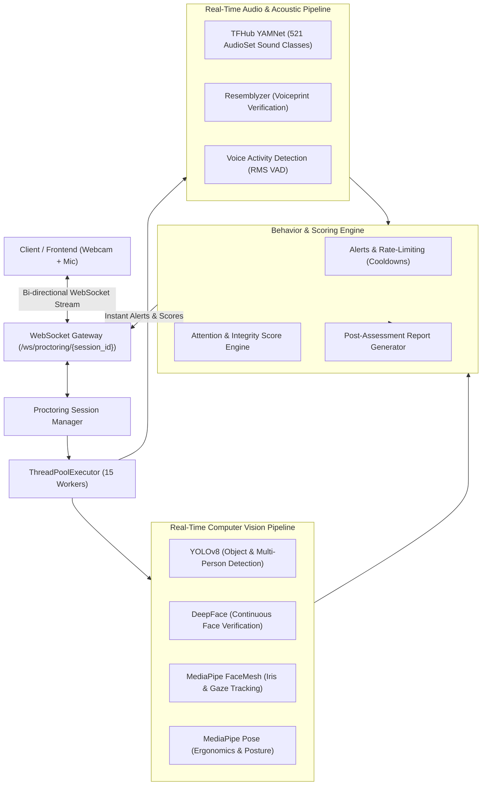
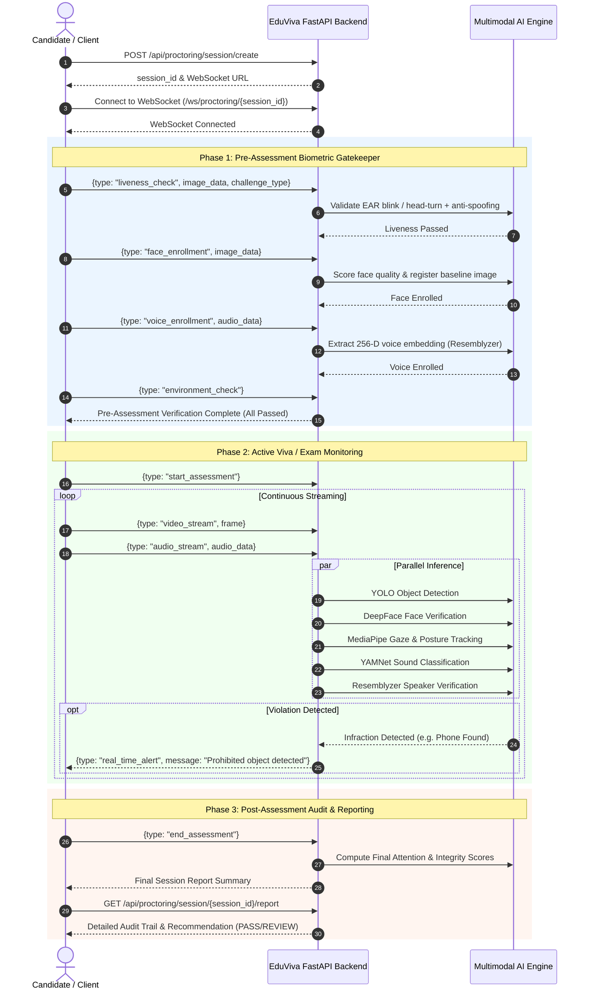

# EduViva 🎓🤖
> **Next-Generation AI-Powered Remote Proctoring & Viva Assessment Platform**

[](https://www.python.org/)
[](https://fastapi.tiangolo.com/)
[](https://github.com/ultralytics/ultralytics)
[](https://developers.google.com/mediapipe)
[](https://tfhub.dev/google/yamnet/1)
[](https://github.com/serengil/deepface)
[](https://websockets.readthedocs.io/)

---

## 📌 Table of Contents
1. [Overview](#-overview)
2. [Key Features](#-key-features)
3. [Architecture Overview](#-architecture-overview)
4. [Proctoring Pipeline & AI Engines](#-proctoring-pipeline--ai-engines)
5. [Repository Structure](#-repository-structure)
6. [API & WebSocket Specification](#-api--websocket-specification)
7. [Getting Started & Installation](#-getting-started--installation)
8. [Configuration & Thresholds](#-configuration--thresholds)
9. [Session Lifecycle & Workflow](#-session-lifecycle--workflow)
10. [Roadmap & Future Enhancements](#-roadmap--future-enhancements)
11. [License & Ethical Use](#-license--ethical-use)

---

## 🌟 Overview

**EduViva** is an intelligent, automated remote proctoring and assessment ecosystem engineered for online viva voce examinations, tests, and remote interviews. By unifying real-time computer vision, acoustic event detection, and biometric speaker identification, EduViva ensures academic integrity and fairness without requiring human supervisors for every session.

The core engine is built on **FastAPI** with asynchronous **WebSocket** streaming, allowing continuous low-latency video and audio stream processing across multi-threaded AI inference pipelines.

---

## ✨ Key Features

### 1. 🛡️ Pre-Assessment Identity & Environment Gatekeeper
Before an assessment unlocks, candidates must pass a mandatory four-stage biometric onboarding process:
- **Interactive Challenge-Response Liveness Detection**: Prompts candidates with randomized physical challenges (blinking, looking left, looking right) with Eye Aspect Ratio (EAR) tracking and Laplacian variance texture anti-spoofing to block photo and pre-recorded video replay attacks.
- **Biometric Face Enrollment**: Validates facial image quality (lighting/brightness, sharpness, face-to-frame ratio) and captures reference templates.
- **Voiceprint Enrollment**: Records 5–15 seconds of audio and extracts a 256-dimensional neural voice embedding.
- **Environment Diagnostics**: Validates hardware peripherals (webcam and microphone clarity) and tests background noise baseline.

### 2. 👁️ Real-Time Computer Vision & Visual Proctoring
- **Prohibited Item Detection**: Ultralytics **YOLOv8** continuously scans for unauthorized objects (cell phones, laptops, secondary monitors, textbooks, notes).
- **Multiple Person & Absence Detection**: Flags multiple people in the camera frame or when the test-taker leaves their seat.
- **Continuous Facial Verification**: **DeepFace** cross-references the live stream against the enrolled baseline template to prevent proxy test-takers or seat swapping.
- **Iris Gaze Tracking**: **MediaPipe FaceMesh** (468+ landmarks) tracks pupil and iris deflection, detecting gaze diversion from the test area and recording cumulative gaze-away intervals.
- **Ergonomic Posture Analysis**: **MediaPipe Pose** detects slouching, turning sideways, head propping, or abnormal body orientation.

### 3. 🎙️ Acoustic Surveillance & Voice Verification
- **Acoustic Scene Classification**: Google's **YAMNet** (trained on AudioSet with 521 audio classes) identifies whispering, side conversations, keyboard clicks, background chatter, or abrupt loud sounds.
- **Continuous Speaker Authentication**: **Resemblyzer** compares streaming candidate speech against their enrolled voiceprint via cosine distance, ensuring only the authenticated candidate speaks during the viva.
- **Voice Activity Detection (VAD)**: Real-time RMS audio chunk evaluation filters ambient background noise from actual speech segments.

### 4. 📊 Behavioral Scoring & Real-Time Alert Engine
- **Dynamic Scoring**:
  - **Attention Score (0–100%)**: Dynamically deducted based on cumulative gaze-away time and acoustic noise frequency.
  - **Integrity Score (0–100%)**: Decreases on detection of prohibited objects, unauthorized persons, or biometric authentication mismatches.
- **Intelligent Cooldown & Rate-Limiting**: Prevents notification flooding while immediately reporting critical violations over WebSockets.
- **Comprehensive Audit Report**: Detailed post-exam report containing violation timelines, behavioral scores, captured snapshots, and automated verdict recommendations (`PASS` vs. `REVIEW_REQUIRED`).

---

## 🏛️ Architecture Overview

The EduViva backend utilizes an asynchronous event-driven architecture powered by FastAPI and Python's `ThreadPoolExecutor` for parallel AI inferencing.



---

## 🧠 Proctoring Pipeline & AI Engines

| Module | Core Technology | Primary Responsibility |
| :--- | :--- | :--- |
| **`main.py`** | FastAPI, WebSockets, AsyncIO | Master orchestrator, session state coordinator, WebSocket hub, and report generator |
| **`liveness_detection.py`** | MediaPipe FaceMesh, OpenCV | Interactive challenge-response liveness (blink EAR, head turns) & texture anti-spoofing |
| **`face_verify.py`** | DeepFace, Haar Cascade | Facial template enrollment, quality assessment, and continuous candidate verification |
| **`voice.py`** | Resemblyzer, SciPy | 256-D voice embedding enrollment, speaker verification, and VAD audio chunking |
| **`environ_noise.py`** | TensorFlow Hub (YAMNet) | Real-time classification of 521 acoustic categories and noise event detection |
| **`gaze_posture.py`** | MediaPipe FaceMesh & Pose | Iris center detection, eye gaze direction, forward head posture, and spinal alignment |
| **`object.py`** | Ultralytics YOLOv8 Nano | Real-time detection of prohibited hardware (phones, laptops, books, paper) |

---

## 📂 Repository Structure

```
EduViva/
├── .gitignore                      # Git ignore rules (venv, temporary cache)
├── README.md                       # Comprehensive project documentation
└── fast-api/                       # Core proctoring microservice
    ├── main.py                     # Application entry point, WebSocket hub, session router
    ├── requirements.txt            # Python dependencies
    ├── object.py                   # Prohibited object detection (YOLOv8)
    ├── face_verify.py              # Facial enrollment and verification (DeepFace)
    ├── environ_noise.py            # Acoustic environmental classifier (YAMNet)
    ├── gaze_posture.py             # MediaPipe gaze and posture analysis
    ├── liveness_detection.py       # Challenge-response liveness & anti-spoofing
    ├── voice.py                    # Voiceprint enrollment and speaker verification
    ├── yamnet_class_map.csv        # AudioSet 521 class classification map
    ├── yolov8n.pt                  # Pretrained YOLOv8 Nano weights
    ├── proctoring_logs.log         # System execution and violation audit log
    └── sessions/                   # Session-specific artifacts and snapshots (runtime)
```

---

## 📡 API & WebSocket Specification

### 1. REST Endpoints

#### Session Management
- `POST /api/proctoring/session/create`
  - **Body**: `{"candidate_id": "STU1234", "exam_id": "VIVA2026"}`
  - **Response**: Returns unique `session_id` and WebSocket connection URL.
- `GET /api/proctoring/session/{session_id}/status`
  - **Response**: Current status (`initialized`, `pre_assessment`, `active`, `completed`), biometric progress, and real-time scores.
- `GET /api/proctoring/session/{session_id}/report`
  - **Response**: Comprehensive audit summary, chronological violation log, and final verdict.
- `GET /api/proctoring/sessions/active`
  - **Response**: List of all currently active proctoring sessions.
- `DELETE /api/proctoring/session/{session_id}`
  - **Response**: Forcibly terminates and archives a session.
- `GET /api/health`
  - **Response**: Health check with active session counters and timestamp.

#### Modular AI Routers
- `/api/object/*` - Direct endpoints for YOLO object inference.
- `/api/face/*` - Direct face verification and image quality evaluation.
- `/api/noise/*` - Standalone acoustic classification queries.
- `/api/gaze/*` - Standalone gaze estimation and posture evaluation.
- `/api/liveness/*` - Standalone liveness challenge validation.
- `/api/voice/*` - Standalone voice enrollment and cosine verification.

### 2. WebSocket Protocol (`/ws/proctoring/{session_id}`)

#### Inbound Messages (Client ➡️ Server)
```jsonc
// 1. Start Pre-assessment verification
{ "type": "start_pre_assessment" }

// 2. Perform liveness challenge (base64 image)
{ "type": "liveness_check", "image_data": "data:image/jpeg;base64,...", "challenge_type": "blink" }

// 3. Face enrollment (base64 reference frame)
{ "type": "face_enrollment", "image_data": "data:image/jpeg;base64,..." }

// 4. Voice enrollment (base64 audio bytes / WAV)
{ "type": "voice_enrollment", "audio_data": "..." }

// 5. Environmental diagnostic check
{ "type": "environment_check", "image_data": "...", "audio_data": "..." }

// 6. Begin live assessment
{ "type": "start_assessment" }

// 7. Continuous video frame stream (active assessment)
{ "type": "video_stream", "frame": "data:image/jpeg;base64,..." }

// 8. Continuous audio chunk stream (active assessment)
{ "type": "audio_stream", "audio_data": "..." }

// 9. Conclude session
{ "type": "end_assessment" }
```

#### Outbound Messages (Server ➡️ Client)
- `pre_assessment_started` / `pre_assessment_update`: Instructions and progress status.
- `real_time_alert`: Immediate alerts (e.g., `cell phone detected`, `multiple faces present`, `loud noise detected`).
- `violation_alert`: Persistent logged infraction with severity level (`low`, `medium`, `high`, `critical`).
- `assessment_ended`: Final assessment summary containing integrity metrics.

---

## 🚀 Getting Started & Installation

### Prerequisites
- **Python**: `3.9`, `3.10`, or `3.11`
- **System Peripherals**: Functional Webcam and Microphone
- **Operating System**: Windows 10/11, macOS, or Linux (Ubuntu 20.04+)
- **Git**

### Installation Steps

1. **Clone the Repository**:
   ```bash
   git clone https://github.com/VANSHKAKKAR04/EduViva.git
   cd EduViva/fast-api
   ```

2. **Create and Activate a Virtual Environment**:
   - **Windows (PowerShell)**:
     ```powershell
     python -m venv venv
     .\venv\Scripts\Activate.ps1
     ```
   - **Linux / macOS**:
     ```bash
     python3 -m venv venv
     source venv/bin/activate
     ```

3. **Install Dependencies**:
   ```bash
   pip install --upgrade pip
   pip install -r requirements.txt
   ```

4. **Verify Pretrained Model Assets**:
   Ensure the following model assets are in `fast-api/`:
   - `yolov8n.pt` *(YOLOv8 Nano weights - included in repository)*
   - `yamnet_class_map.csv` *(AudioSet class taxonomy - downloaded automatically if absent)*

5. **Start the Proctoring Server**:
   ```bash
   python main.py
   ```
   *Or with Uvicorn CLI directly:*
   ```bash
   uvicorn main:app --host 0.0.0.0 --port 8000 --reload
   ```

6. **Access Interactive Documentation**:
   - **Swagger UI**: [http://localhost:8000/docs](http://localhost:8000/docs)
   - **ReDoc**: [http://localhost:8000/redoc](http://localhost:8000/redoc)
   - **Health Check**: [http://localhost:8000/api/health](http://localhost:8000/api/health)

---

## ⚙️ Configuration & Thresholds

Proctoring sensitivity and penalties can be configured in `fast-api/main.py`:

```python
PROCTORING_CONFIG = {
    "max_gaze_away_duration": 10,       # Max tolerated gaze away time (seconds)
    "max_noise_incidents": 3,           # Allowed background noise incidents
    "prohibited_objects": {             # Detected classes that trigger immediate alerts
        "cell phone", "book", "paper", "laptop", "tablet"
    },
    "min_face_confidence": 0.7,         # Facial detection confidence threshold
    "max_people_allowed": 1,            # Maximum allowed persons in view
    "alert_thresholds": {
        "gaze_away": 5,                 # Seconds before triggering a gaze alert
        "noise_level": 0.8,             # Noise severity threshold
        "face_not_detected": 3,         # Seconds without face before alert
        "multiple_faces": 1             # Immediate alert on secondary person
    }
}
```

---

## 🔄 Session Lifecycle & Workflow



---

## 🗺️ Roadmap & Future Enhancements

- [ ] **Conversational AI Viva Examiner**: Integration of multimodal LLMs to dynamically generate viva questions based on student answers and syllabi.
- [ ] **WebRTC Streaming**: Upgrading raw base64 WebSocket frame streaming to low-latency WebRTC data channels for higher throughput.
- [ ] **Instructor Live Monitoring Dashboard**: Web-based supervisor cockpit displaying grid views of all concurrent active candidates with flagged violation markers.
- [ ] **Head Pose Estimation via PnP Algorithm**: 3D yaw, pitch, and roll calculation using facial landmark projections.
- [ ] **Dockerized Deployment**: Production `Dockerfile` and `docker-compose.yml` configurations with GPU acceleration support (`CUDA`).

---

## ⚖️ License & Ethical Use

This project is developed for educational and academic research purposes. When deploying automated proctoring software:
1. **Candidate Consent**: Explicit permission should always be obtained prior to collecting biometric, video, or audio data.
2. **Data Minimization**: Video frames and audio streams are processed in-memory for real-time inference, and sensitive biometrics should be encrypted or scrubbed following institutional retention guidelines.
3. **Human-in-the-Loop**: Automated flags should serve as decision-support indicators for human reviewers rather than immediate grounds for punitive disqualification.

---

<p align="center">
  <b>EduViva</b> • Ensuring Fairness, Integrity, and Excellence in Online Assessments.
</p>

